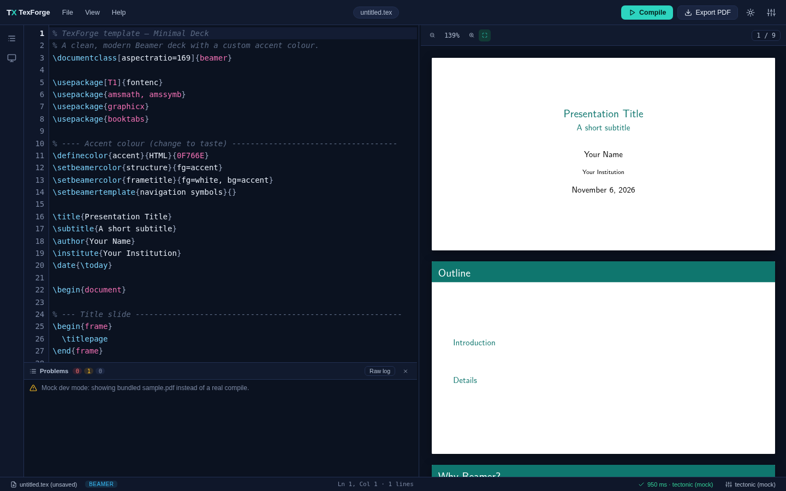
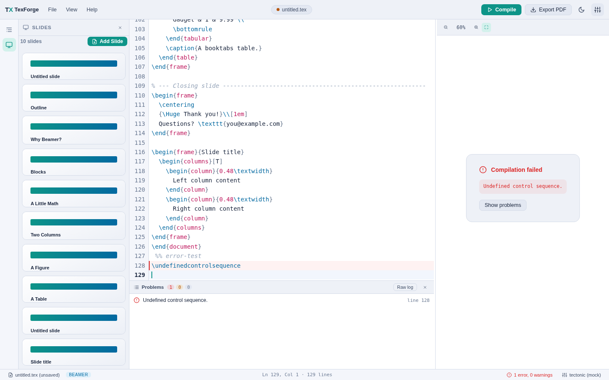

# TexForge

A cross-platform LaTeX editor with a live PDF preview, Beamer slide
management and reusable document templates — built with **Tauri 2**,
**React + TypeScript**, **CodeMirror 6** and **pdf.js**.




## Features

- **Split view** — LaTeX source on the left, live PDF preview on the right,
  with a draggable divider.
- **Real code editor** — CodeMirror 6 with LaTeX syntax highlighting, line
  numbers, optional word wrap, search, bracket matching and LaTeX
  autocompletion (`\commands` and `\begin{…}` environments expand into
  full snippets).
- **Live preview** — continuous-scroll pdf.js rendering with zoom, fit-width
  and a page indicator. The scroll position is preserved across recompiles
  of same-length documents.
- **One-click compile & export** — `Ctrl+Enter` compiles, `Ctrl+E` exports
  the compiled PDF via a native save dialog (plus “Show in folder”).
- **Helpful error reporting** — the TeX log is parsed into clickable
  errors / warnings / bad boxes; clicking an error jumps to the line, which
  is also highlighted in the editor. A raw-log view is one click away.
- **PowerPoint-style templates** — a gallery of Beamer deck templates
  (Minimal Deck, Classic Academic, Dark Tech Talk, Blank Beamer) when
  creating a new document. Save any document as your own template.
- **Slide management** — a slides sidebar lists every Beamer frame with a
  mini thumbnail; insert new slides from a layout picker (Title + Content,
  Two Columns, Section Divider, Image + Caption, …), and reorder,
  duplicate or delete frames like PowerPoint slides.
- **Outline pane** — sections, subsections and frame titles with
  click-to-jump.
- **Solid file handling** — open / save / save-as, recent files, an
  unsaved-changes guard when switching or exiting, drag & drop `.tex`
  files onto the window, and optional reopen-last-file on launch.
- **Dark & light themes**, persisted settings, no telemetry.

## Compilation engines (hybrid)

TexForge automatically picks the best available engine:

1. **System TeX** — `xelatex` → `pdflatex` → `lualatex` (TeX Live / MiKTeX),
2. **tectonic** if it is on your `PATH`,
3. a **custom engine binary** you configure in Settings,
4. the **built-in WASM engine** (SwiftLaTeX PdfTeX) shipped inside the app —
   no installation required. It runs against an **offline TeX Live snapshot
   bundled with the app** (`public/wasm-engine/texlive/`, ~250 files: the
   prebuilt format, LaTeX base, amsmath, geometry, hyperref, beamer + pgf,
   booktabs, listings, xcolor and CM / Latin Modern fonts), so all built-in
   templates compile fully offline. (The original SwiftLaTeX package CDN,
   `texlive2.swiftlatex.com`, is offline — the snapshot replaces it.)

If nothing is available, the preview shows a guided setup card with
per-OS install instructions.

> Note: the WASM engine compiles self-contained documents (a single
> `.tex` file) using the bundled snapshot. If your document needs packages
> outside the snapshot (e.g. tikz libraries, biblatex) or `\input`s /
> includes images from disk, install a system engine so TexForge can run
> it with full package coverage.

## Getting started

### Prerequisites

- **Node.js 18+** and npm
- **Rust** (stable) — https://rustup.rs
- Platform build tools:
  - **Windows**: Visual Studio Build Tools (C++ workload) + WebView2 (preinstalled on Win 10/11)
  - **Linux**: `sudo apt install libwebkit2gtk-4.1-dev build-essential curl wget file libxdo-dev libssl-dev libayatana-appindicator3-dev librsvg2-dev` (Debian/Ubuntu; equivalents for Fedora)
- Optional: a TeX distribution (TeX Live / MiKTeX) or `tectonic` — not
  required to run the app thanks to the WASM fallback.

### Development

```bash
npm install
npm run tauri dev     # run the desktop app with hot reload
```

You can also develop the UI in a plain browser (mocked backend, sample
PDF) — handy when tweaking CSS:

```bash
npm run dev           # http://localhost:1420
```

### Build installers

```bash
npm run build:win     # Windows — NSIS installer (.exe)
npm run build:linux   # Linux  — .deb + AppImage
# or plain:
npm run tauri build   # platform defaults
```

Artifacts land in `src-tauri/target/release/bundle/`.

### Continuous integration and releases

The GitHub Actions workflows in `.github/workflows/` provide:

- **CI** — builds the frontend and checks Rust formatting and compilation on
  pushes and pull requests.
- **Release builds** — when a GitHub Release is published, builds and attaches
  Windows x64 (NSIS), macOS Intel + Apple Silicon (DMG), and Linux x64 (DEB +
  AppImage) installers to that same release using
  [tauri-action](https://github.com/tauri-apps/tauri-action).

The macOS workflow uses ad-hoc signing because Apple Developer signing and
notarisation credentials are not included. macOS may therefore ask users to
approve the app in **System Settings → Privacy & Security** before opening it.

Dependabot also checks npm, Cargo, and GitHub Actions dependencies weekly.

## Keyboard shortcuts

| Keys | Action |
| --- | --- |
| `Ctrl+Enter` | Compile |
| `Ctrl+S` | Save (recompiles if “compile on save” is on) |
| `Ctrl+E` | Export PDF |
| `Ctrl+N` / `Ctrl+O` | New from template / Open |
| `Ctrl+F` | Find in document |
| `Ctrl +` / `Ctrl −` / `Ctrl 0` | Preview zoom in / out / reset |
| `Esc` | Close dialogs and pop-ups |

## Project structure

```
├── src/                     React frontend
│   ├── components/          panes, dialogs, menus
│   ├── editor/              CodeMirror setup (language, theme, completion)
│   ├── lib/                 tauri API layer, mocks, WASM engine, log parsing
│   ├── builtinTemplates.ts  the built-in Beamer templates
│   └── store.ts             zustand store (document, compile, UI state)
├── src-tauri/               Rust backend
│   └── src/
│       ├── compile.rs       engine detection, compile pipeline, log parser
│       ├── dialogs.rs       native file dialogs
│       ├── fsops.rs         file IO, recents, misc commands
│       └── templates.rs     user template persistence
├── public/wasm-engine/      SwiftLaTeX WASM engines (EPL-2.0 OR GPL-2.0+CE)
└── .github/workflows/       cross-platform release CI
```

## Troubleshooting

- **Linux build fails on webkit** — install the packages listed under
  Prerequisites (make sure it is `libwebkit2gtk-4.1-dev`, the `-4.0` one is
  for Tauri v1).
- **“No LaTeX engine found”** — install TeX Live / MiKTeX / tectonic from
  the card shown in the preview pane, then hit *Re-detect*, or switch to
  the built-in WASM engine.
- **WASM engine never finishes the first compile** — it is downloading
  packages; a Beamer deck fetches a few MB on first use.
- **`pdflatex` not found although MiKTeX is installed** — make sure
  MiKTeX’s `bin` directory is on the `PATH` TexForge inherits.

## License

TexForge itself is MIT-licensed (see `LICENSE`). The bundled WASM engines
in `public/wasm-engine/` are from
[SwiftLaTeX](https://github.com/SwiftLaTeX/SwiftLaTeX) — Copyright (C) 2019
Elliott Wen — licensed under the Eclipse Public License 2.0 (or
GPL-2.0-with-classpath-exception, at your option).
